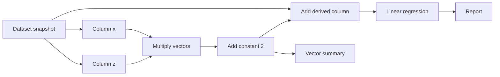

# The Kitchen

The Kitchen is ML Cookbook's native workspace for connecting data operations into a runnable graph. Capture a dataset, take columns out as vectors, branch through transformations, assemble the results into a dataset, and inspect an analysis. The wiring is editable; a graph can have several independent result branches.

## Build a feature pipeline

1. Import your CSV or Parquet file in **Data**, then open **Kitchen** in the sidebar.
2. Choose **Dataset snapshot** in the operation selector and click **Add**. With the node selected, click **Use active dataset**. This captures an independent copy. Importing another active file later does not replace it.
3. Add a **Column vector** for each input you need. Connect the snapshot's `data` output to each column node's `data` input, then choose its column in **Settings**. A column node exposes both its values (`vector`) and a boolean missing-value mask (`missing`).
4. Add **Vector map** for a row-wise transformation, or **Combine vectors** for two aligned inputs. For example, connect columns `x` and `z` to the left/right inputs of a multiplication, then add a constant on a new map node. This produces `x * z + 2` without changing the source columns.
5. Use **Add column** to attach that vector to the original dataset under a new name. Alternatively, **Build dataset** starts a new one-column dataset; further Add column nodes can assemble its predictors and target. Existing column names cannot be overwritten. **Select columns** optionally retains columns and changes statistical roles without converting values.
6. Connect the resulting dataset to **Linear regression** or **Model comparison**. Choose the target and predictors, then adjust model settings and **Preprocessing & validation…**. Learned imputation/scaling/encoding is still fitted inside the recipe's training pipeline.
7. Connect the analysis `result` to **Report**, then click **Run workflow**. **Run to selected** executes only the selected node and its ancestors. Each explicit run repeats that requested path; selecting completed output does not run it again.
8. Select a node and open **Output** to inspect its preview, statistics or model report. The completed-output selector chooses a specific port when a node has several outputs. **Run details** records the settings, consumed ports, artifact references, timestamp and runtime versions. Warnings remain accessible above the inspector.

Connect ports by dragging between circles, clicking an output then an input, or using **Connect…** for keyboard access. Only compatible dataset, vector and analysis ports connect; each input has one producer, while an output can feed several consumers. Required inputs, cycles, settings and column applicability are validated before fitting.



## Available operations

| Operation | Inputs → outputs | Use |
|---|---|---|
| Dataset snapshot | → `data` | Bind an explicitly captured ordinary dataset |
| Select columns | `data` → `data` | Retain columns and set statistical roles without converting values |
| Column vector | `data` → `vector`, `missing` | Extract values and a missing-value mask |
| Vector map | `vector` → `vector` | Add/multiply a constant; log, exp, square root, absolute value, square; compare with a constant |
| Combine vectors | `left`, `right` → `vector` | Add, subtract, multiply, divide, or compare two numeric vectors |
| Build dataset | `vector` → `data` | Start a dataset under a chosen column name |
| Add column | `data`, `vector` → `data` | Append an aligned vector under a new name |
| Filter rows | `data`, `mask` → `data` | Keep rows where a boolean mask is true; missing mask entries are excluded |
| Vector summary | `vector` → `result` | Inspect observed/missing counts, numeric statistics or observed value counts |
| Correlation | `left`, `right` → `result` | Pearson or Spearman association between aligned numeric vectors |
| Linear regression | `data` → `result` | Ordinary least squares, ridge or lasso with the existing evaluation pipeline |
| Model comparison | `data` → `result` | Ridge versus forest using shared training folds and a separate test holdout |
| Report | `result` → inspected report | Inspect a completed analysis branch |

Numeric kernels require numeric roles and actual numeric values. Labels and strings are not converted implicitly. A math operation's **Invalid results** setting either stops with an error or marks invalid values missing and records a warning. Existing missing entries propagate without changing row order. Comparisons produce nullable boolean vectors for filtering or dataset assembly.

Vectors carry their source snapshot and exact zero-based row positions. Combining or appending requires the same ordered lineage, even if two unrelated inputs have identical index labels or row counts. Duplicate index labels remain valid. After filtering, extract further vectors from that filtered dataset when they need to align with its retained rows.

Selecting a target also checks expression lineage. A predictor built from that selected target or its alias is rejected. Shared original inputs in separately derived target/predictor definitions can instead produce a warning—for example, a ratio target and its denominator. Review mathematical coupling and whether the predictors are available at prediction time. Independent model branches do not create a shared-fold model-selection experiment; that guarantee belongs to each **Model comparison** node.

## Edit and inspect

Drag nodes to move them, drag empty canvas space to pan, and use **Ctrl+wheel** to zoom. **Fit graph** frames the drawing. With the canvas focused, Left/Right selects nodes and Delete removes the selected node or connection. **Undo/Redo** (Ctrl+Z/Ctrl+Y) covers node, connection, settings and position edits. The last 50 edits remain available while navigating around the app.

## Export, reuse and reopen

Select a completed output port and use **Export…** for its full data or recorded analysis result. Data/vector outputs offer Parquet or CSV values; analysis outputs offer JSON. Use Parquet for typed data and index preservation. A `.mlck` file additionally retains statistical roles, lineage and graph provenance.

**Use dataset** explicitly copies a current completed dataset output into ordinary **Data**, ready for another recipe. The Kitchen keeps its source, graph and completed results. Rerun a stale path before accepting its data; older completed values remain available for inspection and export. This also lets you use a derived dataset with a recipe that does not yet have a Kitchen analysis node.

**Save Kitchen…** writes a version-2 `.mlck` document containing the current graph/settings/layout/selection, source snapshots and full completed data artifacts. Vectors, derived datasets and positional lineage use checksummed Parquet members; JSON holds reports, previews and references. Older artifacts needed by retained stale results remain available. **Open Kitchen…** restores this data without fitting, executing graph operations or rereading original source paths.

Version-1 Kitchen files still open. Their data outputs contain only the earlier previews; rerun the desired paths to materialize full exportable artifacts. Existing single-recipe `.mlcb` experiments keep their format and header actions. Opening a Kitchen replaces that Kitchen document; ordinary data, examples and Movement Study sessions remain independent.

Changed nodes and their descendants show **Stale** while retaining their last completed output. Reverting a change can make that output current again. A failed or cancelled attempt keeps the previous output and its original settings/input provenance. Cancellation is cooperative between operations; an operation already in progress, including a classical model fit, finishes before the next one is prevented. File save/open/capture jobs do not offer cancellation.

The editor supports an acyclic graph of up to 100 nodes and 200 connections. Controls reject saved settings they cannot reproduce exactly rather than silently clamping them. Model settings currently expose 1–1000 forest trees, depth 1–100 or unlimited, 2–20 CV folds, a .05–.50 test fraction and a nonnegative signed-32-bit seed. Ridge alpha is .0001–10000 with four decimal places. Map constants use six decimal places within ±1e12; correlation confidence uses four decimal places from .0001 to .9999. Unary operations such as log and square hide the unused constant control.

## Python use

Kitchen APIs are deliberately imported from their submodules; root recipe exports are unchanged. This example assumes `data` is an existing `Dataset` with numeric columns `x` and `y`:

```python
from mlcookbook.kitchen import (
    KitchenDocument, KitchenGraph, KitchenNode, KitchenEdge, default_settings, run_graph,
)
from mlcookbook.kitchen_io import save_kitchen, load_kitchen

graph = KitchenGraph(
    nodes=[
        KitchenNode("data", "dataset", {"snapshot": "my-data"}),
        KitchenNode("x", "column", {"column": "x"}),
        KitchenNode("square", "map", default_settings("map") | {"operation": "square"}),
        KitchenNode("table", "add_column", {"name": "x_squared"}),
        KitchenNode("model", "linear", default_settings("linear") |
                    {"target": "y", "features": ["x_squared"]}),
        KitchenNode("report", "report", {}),
    ],
    edges=[
        KitchenEdge("data", "data", "x", "data"),
        KitchenEdge("x", "vector", "square", "vector"),
        KitchenEdge("data", "data", "table", "data"),
        KitchenEdge("square", "vector", "table", "vector"),
        KitchenEdge("table", "data", "model", "data"),
        KitchenEdge("model", "result", "report", "result"),
    ],
)
execution = run_graph(graph, {"my-data": data})
result = execution.run.to_dict()  # JSON-safe, no estimators or Dataset objects
document = KitchenDocument(graph, {"my-data": data}, {"my-data": {"name": "measurements.parquet", "source": {}}})
document.accept_execution(execution)  # Retain full completed runtime artifacts too.
save_kitchen("experiment.mlck", document)
restored = load_kitchen("experiment.mlck")  # Restore; do not execute the graph.
```

Runtime datasets/vectors are separate from JSON result records. `KitchenDocument.accept_execution()` keeps the complete artifacts needed for saving and exporting, including older artifacts referenced by retained results. The graph core never imports Qt; the GUI renders plain data supplied by `app.py`.

## Prototype scope

The current analysis nodes are summaries, correlation, linear regression and regression comparison. The supported operations can be freely composed and branched; additional recipes and kernels can be added deliberately. LLM generation/derivation nodes, reusable fitted-model Fit/Predict nodes, learned graph-level transforms and arbitrary Python execution remain separate scopes. The installed shortcut and separate preview build paths are recorded in `ADAM.md`.
