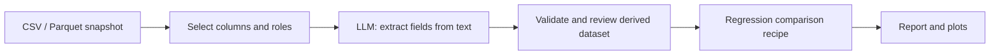

# Roadmap

Originally features left for hands-on implementation; most were built at Adam's request on 2026-10-12 (marked [x]). Each should follow the existing patterns: schema-validated inputs, frozen result dataclasses with warnings, leakage-safe pipelines, sklearn/scipy for the math.

## Local LLM and workflow graphs

Requested by Adam on 2026-10-19. The direction is one desktop workbench: choose a local inference engine, run useful tasks on data, and connect those tasks to existing ML recipes in a visible, repeatable workflow.

**Graph analysis means composing recipes as an executable workflow graph inside ML Cookbook.** Each node has explicit inputs, settings, outputs, and a report. Analytical charts remain available beside the graph. The canvas and controls use the existing Qt app; a browser is not required.

**Ollama and llama.cpp plugins mean selectable ML Cookbook inference integrations.** Start with small connector modules and an explicit engine list. Both connect to an existing local server initially; automatic installation, model downloads, and managed server processes are a later milestone. The current PyTorch engine remains available through its optional extra.

### Delivery order

Effort includes core behavior, GUI, tests, persistence, documentation, and Windows verification. These are relative sizes, not delivery dates.

| Order | Milestone | Effort | Completion checkpoint |
|---|---|---|---|
| 0 | Existing PyTorch foundation | Complete locally | Local prompts/rows, cancellation, provenance, saved outputs, real-model and frozen-runtime checks |
| 1 | Ollama plugin | Complete locally | Installed local models, streamed prompts/rows, cancellation, saved/offline outputs |
| 2 | llama.cpp plugin | Complete locally | Direct local GGUF server, SSE prompts/rows, cancellation, offline saved outputs |
| 3 | Repeatable LLM data workflows | Complete locally | Bound templates, validated fields, derived snapshots, retries, saved-run comparison and export |
| 4 | Workflow graph core and persistence | Large | Execute and reopen a small typed graph without depending on the GUI |
| 5 | Graph editor and analysis inside Qt | Large | Build, run, inspect, edit, and reopen that graph visually |
| 6 | Managed runtime setup | Optional, medium–large | Start/stop an explicitly configured runtime from the app |

The Linux LLM CI runtime-library fix is included in the working tree; confirmation on GitHub awaits the next commit/push. Local tests cover both inference engines. The published v1.0.0 download predates the PyTorch/Ollama recipe; future release notes should distinguish local builds from published downloads.

Adam's long-term workshop goal includes elementary data-science/ML kernels that can be spliced into larger functions. Begin with the typed, auditable recipe operations below; expand toward smaller selection/transform/matrix/metric kernels as concrete workflows need them. An unrestricted arbitrary-Python node is outside the first graph format. Model architecture inspection for the Silicon Badgers research track is recorded separately at the end of this document.

### 1. Ollama plugin

- [x] Add **Inference engine: PyTorch / Ollama** to the existing LLM screen. Put engine-specific controls in that screen and retain its prompt, row selection, output display, and Save/Open behavior.
- [x] Add a local connection profile, **Test / refresh models**, and an installed-model selector. Default to the local Ollama API. Show model identity, size/quantization/context information when supplied by the server, plus connection/loading/generating/error states.
- [x] Support plain prompts and chat messages, temperature/top-p, supported seed/output limits, and newline-delimited JSON streaming. Keep the stream preview distinct from the last completed result. Handle unavailable servers/models, incomplete streams, timeouts, cancellation, and backend error messages.
- [x] Preserve the existing PyTorch API. Add explicit Ollama request/result data: backend, model identity, submitted prompt/messages, requested settings, outputs, stop reason, timings/token counts, warnings, and provenance. Applied device/precision and exact rendered chat prompts remain unverified; unavailable metrics stay unavailable.
- [x] Record Ollama's model digest and runtime version where available. A model name alone is insufficient identity. Report backend-provided token counts separately from locally measured timings; seeds do not promise identical output across engines or hardware.
- [x] Keep inference connectors usable without importing/installing PyTorch. Standard-library HTTP/JSON adds no dependencies. Start with installed local models and exclude cloud references when the runtime exposes that distinction.

**Done when:** a user with Ollama already running can select a local model, generate/stream/cancel, process bounded text rows, save an experiment, close the app, and reopen the result with Ollama stopped. Rerunning gives a clear connection error and preserves the saved report. Fake-server tests cover fragmented Unicode/JSON streams, errors, cancellation, and provenance; an optional real-runtime smoke check verifies the adapter.

API basis: Ollama provides a [local API](https://docs.ollama.com/api/introduction), [installed-model listing](https://docs.ollama.com/api/tags), [chat generation](https://docs.ollama.com/api/chat), and [NDJSON streaming](https://docs.ollama.com/api/streaming).

Implemented at Adam's request on 2026-10-19. The complete local suite passed (358 tests); fake HTTP tests cover transport/provenance and desktop recovery, including reopening with an unavailable server, unrun engine changes, and legacy PyTorch experiments. Native Windows checks used the existing Ollama 0.40.6 installation with `qwen3.5:9b` (Q4_K_M). No server/model installation or process management was added.

The local Windows executable was rebuilt and launch-checked. Its application modules match the final source; its collected runtime generated with both real Qwen/Ollama and SmolLM2/PyTorch models. This is a local build, separate from the published v1.0.0 release.

### 2. llama.cpp plugin

- [x] Add **llama.cpp server** as another inference engine, with a local server address, connection test, loaded-model selection/information, and model-loading status.
- [x] Connect to an already-running `llama-server` using its health/model endpoints and OpenAI-compatible chat-completions API. Parse SSE separately from Ollama's NDJSON. No OpenAI account or hosted service is involved in this local connection.
- [x] Support generation from the server's GGUF model. Record server-reported model/runtime information, quantization/context details where available, explicitly reported applied options, stop reasons, and actual usage/timing fields. Hash an explicitly selected local GGUF file only, retaining its unverified binding to loaded weights and additional shards/templates; otherwise record an unverified model reference.
- [x] Expose per-request controls separately from server startup settings such as model path, context allocation, and GPU offload. Direct single-model llama-server is supported; router mode, authenticated endpoints, multimodal inputs and tools remain outside this milestone.
- [x] Reuse the existing result/session/experiment flow. Connecting to a user-started server does not give the app ownership of that process. Cancellation and app exit leave unrelated server processes intact. Migrate old Ollama/PyTorch states before validation.

**Done when:** a user starts `llama-server` with a local GGUF, connects from ML Cookbook, generates and cancels, and saves/reopens outputs through the same UI as Ollama/PyTorch. Contract tests use a fake server; a Windows smoke check uses a real GGUF runtime.

API basis: the [llama.cpp server documentation](https://github.com/ggml-org/llama.cpp/blob/master/tools/server/README.md) describes health checks, `/v1/models`, and `/v1/chat/completions`.

Implemented at Adam's request on 2026-10-19. All 397 local tests and Ruff passed, including SSE fragmentation/chunking/multiline data, reasoning, final usage, malformed/incomplete streams, loading/errors, idle cancellation/deadlines, explicit file fingerprints, rows, offline reopening and both generations of saved experiments. Native Windows checks used llama.cpp `b11193-4e7481175` and an external SmolLM2-135M-Instruct Q4_K_M GGUF. Real streaming cancellation left the temporary test server ready. Product code adds no dependencies, model downloads, installation, or process management.

The local Windows executable was rebuilt and launch-checked; fifteen checked application modules match the final source. Its bundled runtime generated with all three engines and verified the explicit GGUF hash. After stopping only the QA-owned server, the native app reopened a real saved llama.cpp result offline and preserved it after a failed rerun. The temporary QA executable was removed; published release assets are unchanged.

### 3. Repeatable local LLM data workflows

- [x] Make saved prompt templates with explicit column bindings. First tasks: summarize text, rewrite text, classify into a user-supplied set of labels, and extract a small set of structured fields.
- [x] Add structured-output requests where supported, then validate the returned JSON/fields independently in the core. Keep raw output, parsed values, per-row validation failures, and exact source-row identity. A requested JSON format does not itself prove the content is correct.
- [x] Preview generated columns beside the source rows. An explicit **Use as derived dataset** action creates a new typed `Dataset`, preserving source values and lineage. Join by recorded row identity and dataset fingerprint, including duplicate index labels and skipped rows. Roles and conversions remain visible choices.
- [x] Add bounded batches with row progress, stop/cancel, and recorded per-row outcomes. Rerun failed/selected rows only when their inputs/settings/model identity are known. Changing a prompt or model marks affected outputs stale.
- [x] Compare saved runs on the same input rows. Draw tokens/second, load/generation time, output length, and structured-field validation rates directly in the app using result data. Add accuracy/F1 or field agreement only when reference labels are actually supplied; distinguish validation rate from semantic accuracy.
- [x] Extend explicit export for generated fields, per-row outcomes, and run metadata. Save prompt template/bindings, source snapshot, model/backend identity, settings, outputs, and versions in experiments. Reopening remains independent of a live runtime or original source file.

**Done when:** import a small table of text, extract two validated fields through either server plugin, inspect failed rows, accept the fields into a derived dataset, compare two saved runs, and reproduce the selection/settings after reopening. Keep reference/test labels out of model inputs when evaluating a predictive workflow.

Implemented at Adam's request on 2026-10-19. The Local LLMs card now exposes extraction/summarization/rewriting/classification presets, explicit literal column bindings, nullable output roles, independent JSON validation and reference-only field agreement. Bounded source-position batches retain per-row failures and completed outcomes on cancellation. Review/retry, typed derived datasets, ten-run experiment history, native comparisons and JSON export are integrated with offline saves and legacy migrations. No dependencies were added. Native QA used Adam's existing Silicon Badgers `Qwen3.5-2B-Q4_K_M.gguf` through an independently started temporary llama-server; two real extraction runs produced the expected fields and were compared, saved/reopened, exported and accepted into another recipe.

Final verification: **440 pytest tests passed**, Ruff/dependency checks passed, and the rebuilt Windows executable launched normally with sixteen checked modules matching source. Its collected runtime generated structured fields through both real server engines and retained PyTorch generation. After the temporary QA server was stopped, the native app reopened/computed comparison/derived data from saved results offline. The published release and Git history are unchanged.

### 4. Workflow graph core and persistence

- [ ] Define a small, versioned graph document: node IDs, known node kinds, plain settings, typed input/output ports, edges, and references to dataset/result artifacts. Use dataclasses and an explicit mapping of supported operations.
- [ ] First node set: **Dataset snapshot**, **Select columns / roles**, **LLM generation**, **Validate / derive columns**, **Existing analysis recipe**, and **Report**. Existing analysis nodes call the current core workflows and return result data.
- [ ] Validate required inputs, port types, missing columns, unknown node kinds, and cycles before expensive execution. Run a directed acyclic graph in a deterministic order, one active job initially, with per-node status and cancellation.
- [ ] Preserve successful node results and the settings/input fingerprints that produced them. Edits mark that node and its descendants stale. Provide **Run to selected node** and **Run workflow**; errors/cancellation keep previous results visibly associated with their original settings.
- [ ] Keep preprocessing, splitting, training-only CV, and final evaluation inside each supervised recipe node. A graph-level preprocessing choice is unfitted configuration. The first graph does not expose reusable fitted-estimator outputs; separate Fit/Predict nodes need their own core-artifact design later.
- [ ] Use the existing model-comparison workflow when promising shared folds/holdout membership. Two independent model branches are not automatically a fair selection experiment. Freeze prompts/model choices before final test assessment, and exclude target information from LLM-derived predictors.
- [ ] Design a workflow save-format revision explicitly, with checksummed typed dataset snapshots, node settings/layout, results, and provenance. Retain version-1 single-recipe `.mlcb` support. Save configuration/data rather than live callables or pickled estimators; model weights stay external. Reopening restores reports without executing nodes or starting runtimes.

**Done when:** tests construct and run a graph without Qt, reject incompatible/cyclic graphs, preserve leakage boundaries and row lineage, mark downstream results stale after edits, and reopen saved results with source files and inference servers unavailable.

### 5. Graph editor and analysis inside ML Cookbook

- [ ] Add a **Workflows** screen in the existing navigation, using Qt's `QGraphicsScene` / `QGraphicsView` and the current theme. `gui/` draws nodes/connections and emits edits; `app.py` coordinates execution; the graph core never imports Qt. No browser or new graph/plotting dependency is needed for the first canvas.
- [ ] Create/delete nodes, connect typed ports, pan/zoom, select a node, edit its settings, and inspect its inputs/outputs. Show invalid connections and validation messages before execution. Reuse recipe controls/report rendering where practical while keeping core validation independent of GUI widgets.
- [ ] Keep Run/Cancel/progress visible, with queued/running/completed/failed/cancelled/stale node states. Selecting a completed analysis opens its existing plots/tables; selecting an LLM node opens its text, per-row outcomes, timing plots, and provenance.
- [ ] Save graph layout and current selections with the workflow. Add keyboard interaction and undo/redo for graph edits. Preserve unrun changes and restore without computation, following the current experiment behavior.

First demonstration workflow:

The derived dataset retains trusted source columns, including any chosen numeric target; only explicitly selected text enters the LLM prompt. Start graph execution with the shorter **Dataset → Regression comparison → Report** path, then add the LLM branch once artifact/row lineage works.

**Done when:** build both example workflows through the canvas, inspect each node's outputs inside the app, edit a prompt and see the affected descendants become stale, run to a selected node, cancel, save, close, and reopen the entire layout and previous reports. Native Windows inspection and a rebuilt executable are part of completion.

### 6. Optional managed runtime setup

- [ ] After the external-server integrations are useful, add runtime profiles for an Ollama installation or a chosen `llama-server` executable/GGUF. Display installed/connected/loading status and actionable setup guidance.
- [ ] Add explicit Start/Stop for processes launched by ML Cookbook, track process ownership, capture startup errors, and handle occupied ports. Start Windows helpers without visible console windows. Do not stop a user-owned service when closing the app.
- [ ] Decide CPU/GPU builds, executable/model acquisition, download progress, storage locations, updates, and redistribution separately before bundling binaries or adding runtime bindings. Keep weights and runner installation outside saved workflow files.

**Done when:** a configured local runtime starts from the app, reports readiness, serves a saved workflow, and stops cleanly through an explicit action without disturbing another running server.

Training/fine-tuning, embeddings/retrieval, multimodal tasks, and arbitrary Python-code nodes remain separate curriculum choices. The first useful milestone is the Ollama connection and saved-run loop; graph execution and the visual editor follow as independently reviewable changes.

## Statistics

- [x] **Chi-square test of independence + Cramér's V** (`statistics/categorical.py`), with a low-expected-count warning and Fisher's exact test for 2x2 tables.
- [x] **One-way ANOVA + Kruskal–Wallis** (`statistics/groups.py`), with eta squared, Levene and per-group Shapiro-Wilk checks, and a recommended test.
- [x] **Pairwise association scan** (`statistics/scan.py`): Spearman / chi-square / Kruskal-Wallis chosen by `VarType`, effect sizes, Benjamini-Hochberg adjusted p-values.
- [x] **Confidence intervals** on correlation coefficients (Fisher z-transform).
- [x] **Normality checks** surfaced as warnings on Pearson.
- [ ] **Mutual information** for mixed-type pairs (`sklearn.feature_selection.mutual_info_*`).

## Machine learning

- [x] **Logistic regression classification workflow** with `classification_metrics`.
- [x] **Cross-validation** utility (`evaluation/cross_validation.py`); every supervised workflow cross-validates its training rows.
- [x] **Regularized regression** (ridge/lasso) as `penalty=`/`alpha=` on `linear_regression`.
- [x] **Random forest classification** (`classification/forest.py`).
- [x] **Tree-based regression**: `decision_tree_regression`, `random_forest_regression`.
- [x] **Multiclass classification** for all three classifiers (macro metrics, per-class metrics, multinomial logistic).
- [x] **K-means clustering workflow** (`clustering/kmeans.py`) with silhouette and an elbow/inertia scan.
- [x] **PCA workflow** (`dimensionality/pca.py`) with explained variance and loadings.
- [x] **Residual diagnostics** for regression (`regression/diagnostics.py`).
- [ ] **Hyperparameter search** (e.g. choose alpha or max_depth by cross-validation, reported as a curve).
- [x] **Fair model comparison, first scope**: ridge and random forest regression on the same materialized split and training folds, one CV comparison table/curve; select by mean CV RMSE and evaluate only the selected model on the test rows. Exact row/fold membership is retained. Built at Adam's request on 2026-10-17; other algorithms and classification comparison remain future extensions.
- [x] **SVM and neural-network recipes**: `svm`/`svm_regression` (kernels, support vectors, standardized SVR target) and `neural_network`/`neural_network_regression` (scikit-learn MLP with loss and early-stopping validation curves).
- [x] **Local LLM inference, first scope**: PyTorch + Transformers generation from local GPT-2/Llama/Qwen2/Qwen3 safetensors checkpoints, typed prompts or bounded text-column rows, chat templates, decoding controls/cancellation, model/runtime provenance, and saved outputs. Built at Adam's request on 2026-10-19 with explicitly approved optional dependencies. Quantized inference is now available through the server connectors above. Training/fine-tuning, embeddings, and model graphs remain future scopes.

## Infrastructure

- [x] **Local CSV/Parquet input** for every ready recipe: preview, schema-role overrides, target/features/positive-class selection, background loading/training.
- [x] **Configurable, recorded preprocessing** (`PreprocessingConfig`, `PreprocessingSummary`): imputation, scaling, encoding, rare-level pooling, missing indicators, datetime features.
- [x] **Import quality**: leading zeros kept, extra missing markers, ISO-8601 date detection, ID-like/constant/mostly-missing column flags.
- [ ] **Visualization module**: functions that take result objects (never raw data + recomputation) and return figures (needs a plotting dependency decision).
- [ ] **`Dataset.dropna()` / row-filtering helpers** returning new `Dataset` instances.
- [ ] **FastAPI service** in a separate `api/` or sibling package: endpoints that wrap analyses and return `result.to_dict()`.
- [x] **CI** (GitHub Actions): ruff, library tests on Ubuntu 3.12/3.13, full app suite on Windows.
- [ ] **mypy** configuration and type-checking in CI.
- [ ] **Property-based tests** with `hypothesis` for schema inference edge cases.
- [x] **Saved experiments**: explicit `.mlcb` save/open for every recipe, with a Parquet dataset snapshot, import options, overrides, current settings, last report/request, run seed/time, versions, and a snapshot fingerprint. Reopening restores without training, including unrun edits. Built at Adam's request on 2026-10-17.
- [ ] **Result export**: standalone metrics/predictions files and fitted-model persistence. Comparison's complete result is already retained in experiment JSON; the other recipes currently save their display reports.

## Directions under discussion

Recorded after the CSV/Parquet milestone on 2026-09-27. These are proposals for Adam to consider, not scheduled work or authorization to implement anything. The learning curriculum above remains intact.

### Candidate data inputs

Relative effort includes the import UI, validation, tests, and packaging, not just calling a reader.

| Candidate | What it would enable | Relative effort and decisions |
|---|---|---|
| TSV (`.tsv`) | Tab-delimited research and application exports | Small: tab parsing already exists for `.csv`; extend extension dispatch/file filters and tests, with tab as the TSV default. |
| Compressed CSV (`.csv.gz`) | Read compressed exports without manual extraction | Small to moderate: make both header validation and data parsing compression-aware. This does not make training out-of-core. |
| Excel (`.xlsx`) | Analyze worksheets directly | Moderate: choose a sheet and header row; define how to handle blank regions and formula cells. An Excel engine such as `openpyxl` would need separate dependency approval. |
| JSON Lines (`.jsonl`/`.ndjson`), then record-array JSON | Analyze event records and application/API exports | Moderate: start with flat records; define missing-field and mixed-type behavior. Nested data needs an explicit flattening choice. |
| SQLite (`.sqlite`/`.db`) | Analyze local database tables without exporting CSV first | Moderate: start with read-only table selection and preview; joins, custom SQL, and remote databases can come later. |
| Feather (`.feather`) | Exchange typed tables with Python/R workflows | Small to moderate: the existing Arrow dependency helps; prioritize when there is a concrete dataset needing it. |

Proposed order: TSV/compressed CSV as convenience additions, Excel as the next major import capability, then JSONL. SQLite and Feather can follow actual dataset needs. Keep each supported input feeding the existing `Dataset` and schema checks so every algorithm benefits.

Technical references: pandas documents [Excel engines and sheet selection](https://pandas.pydata.org/docs/reference/api/pandas.read_excel.html), [JSON and line-oriented records](https://pandas.pydata.org/docs/reference/api/pandas.read_json.html), [SQL query input including sqlite3 connections](https://pandas.pydata.org/docs/reference/api/pandas.read_sql_query.html), and [Feather input](https://pandas.pydata.org/docs/reference/api/pandas.read_feather.html).

### Candidate workflow improvements

A possible product direction is a local analysis workbench where users can inspect data, run suitable methods, understand the results, and reproduce the run.

1. **Import review and data quality:** preserve leading-zero identifiers through parser-level type choices; configurable missing-value markers; explicit numeric/date conversion; flag constant/all-missing columns and likely IDs. Keep cleaning choices visible.
2. **Reproducible projects and useful outputs:** save import options, schema overrides, selected columns, algorithm settings, seed, package versions, and a source-data fingerprint; export metrics and per-row predictions. Explain whether reopening references or includes the original data.
3. **Fair model comparison:** reuse the same holdout rows across compatible algorithms, introduce training-only cross-validation and appropriate metrics, and distinguish classification from regression comparisons. Grouped or time-based splits would be separate explicit choices when rows are not independent.
4. **Broader analysis:** connect the existing correlation core to the GUI, then consider the statistical tests, regularization, regression forests, multiclass classification, PCA, and clustering as individually chosen learning projects. Methods should explain their input requirements and interpretation.
5. **Larger datasets:** measure actual memory/runtime limits before adding sampling, column projection, or batch processing. A reader that streams does not automatically make the estimator train incrementally.

Saved configurations and reports deserve consideration alongside new formats: importing more files is most useful when users can retain and compare the analyses they run.

### Further model-inference workflows

The requested [local LLM and workflow-graph plan](#local-llm-and-workflow-graphs) above replaces the earlier general GGUF proposal. PyTorch, Ollama and llama.cpp inference plus structured row workflows are implemented; graph composition has explicit future milestones. Model acquisition/redistribution and managed runtime setup remain separate from connecting to an existing local server.

### Silicon Badgers architecture research context

Adam's club studies Qwen3.5 2B and llama.cpp internals separately from the recipe workshop. The existing GGUF and architecture notebook in `~/SiliconBadgers/AI_stuff` are external research material. A possible later read-only inspector could show GGUF metadata/tensor shapes, hybrid layer structure and links into the corresponding llama.cpp graph-building code. That is model-architecture inspection; it is distinct from composing executable data workflows, and is not implemented by this milestone. Keep arbitrary Python execution, kernel tracing and activation analysis as explicit research scopes.
