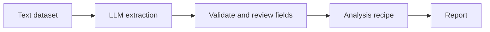

# Using ML Cookbook

A hands-on guide to all twelve desktop recipes, including the three Local LLM engines. Import your own data from the sidebar or explore a bundled example. The examples below are learning exercises, not evidence about real housing markets.

This guide describes current source and local Windows builds. The published v1.0.0 download predates Local LLMs. See the [README](README.md) for installation, model setup, and the Python API overview.

The existing Windows shortcut opens the restored black/violet UI at `dist/MLcookbook/MLcookbook.exe`. The immediately previous app is preserved at `dist/ui-before-restore/MLcookbook`, and the complete pre-redesign app at `dist/ui-original/MLcookbook`. Earlier UI previews remain at `dist/ui-stage1/MLcookbook` through `dist/ui-stage5/MLcookbook`, each with its matching runtime. Future review builds use `dist/ui-preview/MLcookbook`. Examples require an explicit action.

## Start with your data

1. Launch the sidebar preview or source app. **Data** opens first. Click **Open CSV / Parquet…**; expand **CSV import options** first if you need another delimiter, encoding or extra missing markers.
2. Review the preview, **Data checks**, source path/snapshot identity and **Columns and source roles**. Roles here are read-only; they describe statistical meaning and do not convert values.
3. Click **Recipes**, then choose an analysis. It receives the active dataset and waits for your target/features and **Run Analysis**. No example is constructed for this visit.
4. Adjust roles within that recipe if needed. Returning through **Data** or another recipe preserves its unrun choices and previous results; the Data page continues to show the original source roles.
5. Use **Save experiment…** from a recipe to retain its data snapshot, controls and last result. Data alone is not a saved workspace/project. A successful file replacement clears previous recipe sessions; a failed import keeps them.

The sidebar's **Active dataset** identifies your ordinary tabular input. The **Input:** row on each recipe identifies what that screen will use: a file/snapshot and its dimensions, a built-in example, a typed LLM prompt or a Movement Study. Use the adjacent **Open dataset…** to replace a file; CSV options stay in the form. Column-role guidance is available on the column table and in **Recipe reference**. Study imports and reserved groups stay separate; opening a saved study preserves an existing active tabular dataset. Accepting generated LLM fields updates the active dataset while Local LLMs retains its source run.

On first use, **Preparing analysis runtime…** may appear while scientific libraries initialize in the background. The current page stays visible and navigation locks until preparation finishes. This does not train a model or load LLM weights. A failed preparation leaves the page available for retry. File and experiment imports show their own loading status while performing initialization and reading data.

## Your first experiment

For connected operations rather than one recipe, use [The Kitchen walkthrough](KITCHEN.md). Import through Data, capture a dataset node, select columns, connect a comparison and inspect its report. Kitchen graphs save as `.mlck`; recipe experiments below save as `.mlcb`.

1. Launch ML Cookbook from your shortcut, or run `.venv/Scripts/python.exe -m mlcookbook` from the repository.
2. Click **Recipes → Linear Regression**. Opening it does not run an analysis. Choose target/features for your imported file and **Run Analysis**, or click **Run example** for the bundled diabetes example predicting `progression`. Example loading and analysis run in the background.
3. Read the short result summary, actual-versus-predicted plot, test metrics, and warnings. Expand **Model settings** to try ridge or lasso. **Preprocessing & validation...** stays accessible below model settings; the adjacent summary identifies the test split, seed and training-CV folds.
4. Change one setting and click **Run Analysis**. Until that succeeds, the result banner identifies the previous result. Editing controls alone does not retrain a model.
5. Click **Save experiment...** and choose a `.mlcb` file. Return to the recipe list or close the app, then use **Open experiment...** to restore it.

Local LLMs opens a setup screen instead of running a model automatically. Its steps are in [recipe 10](#10-local-llms).

While viewing an example, **Use my data** restores this recipe's own-data report and unrun choices. The sidebar continues to identify your active file while **Input:** identifies the example. **View example** returns to a cached example without rerunning, including invalid unrun edits you need to repair. Example edits stay with that example; **Run Analysis** reruns it. Switching to Data or another recipe and back restores the last view without retraining. Opening a saved example restores its embedded data/results without replacing an existing ordinary dataset. Empty classical setup screens cannot be saved until a dataset/example is loaded.

An experiment saves one recipe, the full typed dataset snapshot, current controls, and the last completed report with the settings that produced it. It also keeps unrun edits. Reopening does not train, contact an inference server, or reread the original CSV/model files. Model weights and fitted classical estimators are not embedded. A failed run leaves the previous completed report visible.

Use **Recipe reference** for applicability, assumptions, parameter meaning, interpretation and limitations. Expand **Python API** there only when you need the callable signature. Expand **Run details** above a completed report to inspect the input/settings recorded for that result and any available runtime/timestamp details. This temporary disclosure does not alter the experiment. A banner appears when settings differ from the displayed result; reverting the changes hides it. The footer shows progress, completion or errors and clears after valid edits.

## Choose a recipe

| Recipe | Question it answers | Practice target / input |
|---|---|---|
| [Linear Regression](#1-linear-regression) | Can a weighted sum of inputs predict a number? | Target `price` |
| [Logistic Regression](#2-logistic-regression) | Can inputs predict a class and its probability? | Target `high_demand` |
| [Decision Trees](#3-decision-trees) | What sequence of splits predicts a class or number? | `high_demand` or `price` |
| [Random Forests](#4-random-forests) | Does averaging many trees improve prediction? | `high_demand` or `price` |
| [K-Means](#5-k-means) | Which rows form similar groups? | Numeric features; no target |
| [PCA](#6-pca) | Which combinations summarize variation in the inputs? | Numeric features; no target |
| [Association Scan](#7-association-scan) | Which selected columns are associated? | Two or more columns; no target |
| [Support Vector Machines](#8-support-vector-machines) | Can a margin or kernel model capture the relationship? | `high_demand` or `price` |
| [Neural Networks](#9-neural-networks) | Does a small multilayer perceptron improve prediction? | `high_demand` or `price` |
| [Local LLMs](#10-local-llms) | Generate text or validated fields with local models | Typed prompt, text rows, or explicit template bindings |
| [Model Comparison](#11-model-comparison) | Does ridge or a forest perform better on shared validation folds? | Target `price` |

## Make a practice CSV

You can use the built-in demos throughout. For one consistent file across every recipe, run this Python block in the project environment, for example in a notebook or Python session. From a terminal in the repository, `.venv/Scripts/python.exe` starts that Python session; paste the block there. It creates `tutorial_homes.csv` in the current folder. It refuses to replace an existing file; choose another filename if you have already generated it.

```python
import numpy as np
import pandas as pd

rng = np.random.default_rng(42)
n = 240
area = rng.uniform(500, 2400, n).round()
bedrooms = rng.integers(1, 5, n)
age = rng.integers(0, 70, n)
distance = rng.uniform(1, 30, n).round(1)
neighborhood = rng.choice(["North", "South", "West"], n)
area_bonus = np.where(neighborhood == "North", 30000, 0)
price = (50000 + 160 * area + 10000 * bedrooms - 650 * age
         - 1400 * distance + area_bonus + rng.normal(0, 20000, n)).round()
score = ((area - 1400) / 700 - (distance - 15) / 10
         + 0.5 * (neighborhood == "North"))
probability = 1 / (1 + np.exp(-score))
high_demand = np.where(rng.random(n) < probability, "yes", "no")

frame = pd.DataFrame({
    "area_sqft": area,
    "bedrooms": bedrooms,
    "age_years": age,
    "distance_km": distance,
    "neighborhood": neighborhood,
    "price": price,
    "high_demand": high_demand,
    "notes": [
        f"Home {i}: {beds} bedrooms, {int(sqft)} square feet, "
        f"{years} years old, in the {place} neighborhood."
        for i, (beds, sqft, years, place)
        in enumerate(zip(bedrooms, area, age, neighborhood))
    ],
})
frame.to_csv("tutorial_homes.csv", index=False, encoding="utf-8", mode="x")
print(frame.head())
```

Import it with **Open CSV / Parquet...**. Check **Preview first 20 rows...** and **Data checks**. If you need a different delimiter, encoding, or missing-value markers, set **CSV import options** before opening the file. A successful replacement clears earlier recipe sessions, so save work you want to keep first.

Use these selections consistently in the exercises:

| Name used in this guide | Select these columns |
|---|---|
| Prediction features | `area_sqft`, `bedrooms`, `age_years`, `distance_km`, `neighborhood` |
| Numeric exploration features | `area_sqft`, `bedrooms`, `age_years`, `distance_km` |
| Regression target | `price` |
| Classification target | `high_demand` |
| LLM input | `notes` only |

**Uncheck every other feature.** In particular, keep `high_demand` out of the price exercise, `price` out of the demand exercise, and `notes` out of classical models. The target itself is excluded from features by the screen. Explicit choices make the exercises reproducible and avoid accidentally giving a model an answer or information unavailable at prediction time.

## Understand the shared controls

**Column roles describe meaning.** `price` is numeric, `high_demand` and `neighborhood` are categorical, and `notes` is text. A numeric customer ID usually belongs to a category rather than a measurement. Changing a role does not clean or convert stored values: a column containing invalid numeric strings needs cleaning before it can be treated as numeric. Review the detected roles after importing.

**Preprocessing & validation** supplies median/mean numeric imputation, categorical missing-value handling, encoding, scaling, rare-level pooling, and optional missing-value flags. Start with recipe defaults and one-hot encoding. Linear models, SVM, MLP, k-means and PCA use standard scaling by default; tree and forest defaults keep real numeric units. Ordinal encoding assigns numeric codes and can imply an order or spacing that unordered categories do not have.

For supervised recipes, preprocessing is fitted on training rows and refitted inside each cross-validation fold. Start with **5 folds**, or **3 folds** for a quicker experiment. Test rows are held out from training and CV. K-Means and PCA fit the selected dataset without a test split or CV. Association Scan and Local LLMs do not use this preprocessing pipeline.

| Output | How to read it |
|---|---|
| Train metrics | How well the fitted model describes rows it learned from |
| Test metrics | Performance on the recipe's held-out rows |
| CV mean ± SD | Average and spread across training-only validation folds |
| MAE / RMSE | Prediction error in target units; lower is better; RMSE emphasizes larger errors |
| R² | Higher is better; zero is a test-set mean-prediction benchmark and negative values are possible |
| Accuracy | Fraction classified correctly; can be misleading with imbalanced classes |
| Precision / recall | How often a positive prediction is right / how many actual positives are found |
| F1 / macro F1 | Precision-recall balance; macro averages give each class equal weight |
| ROC AUC | Ranking discrimination; it does not establish probability calibration |
| Warning summary | Dropped rows, assumptions, convergence, unavailable metrics, or other limits to interpretation |

For binary classification, select the class you care about in the positive-class control. With `high_demand`, choose `yes`. With three or more classes, the app uses multiclass metrics and has no positive-class selector. A blank or unavailable metric is not a score of zero.

A large train-to-validation gap can indicate overfitting. Compare model/settings choices using CV. Once you repeatedly inspect test results to choose settings, that test set is no longer an independent final assessment; use fresh held-out data for that purpose.

## Recipe walkthroughs

### 1. Linear Regression

**Use it for:** a numeric prediction and an interpretable baseline.

1. Open **Linear Regression**, import the practice file, set target `price`, and select the prediction features above.
2. Leave **Penalty → None (ordinary least squares)** for the first run. Keep the default preprocessing and five-fold CV.
3. Click **Run Analysis**. Inspect actual-versus-predicted points and the residual plot, then compare train, test and CV errors.
4. Change **Penalty** to **Ridge (L2)** and **Penalty strength** to `1`. Run again. Try **Lasso (L1)** to see whether coefficients become zero. Save promising settings as separate experiments.

Points near the actual-versus-predicted diagonal have smaller errors. Residuals should not show a strong remaining curve; a widening spread suggests error size changes across predictions. The residual diagnostics in this recipe use training rows, so they complement rather than replace held-out error.

The coefficient table describes conditional associations within this model. With standard scaling, numeric coefficients are per one feature standard deviation, not per original unit. Categorical coefficients describe encoded levels; the intercept and coefficients are not causal effects. Lasso's zero coefficients are a selection outcome, not proof that those variables never matter.

**Try next:** add an irrelevant feature or increase penalty strength, watch CV, and compare against a forest using Model Comparison.

### 2. Logistic Regression

**Use it for:** predicting classes with a linear log-odds baseline. Despite its name, this is classification.

1. Open **Logistic Regression**, target `high_demand`, and use the prediction features.
2. Choose positive class `yes`, leave standard scaling and one-hot encoding, then run.
3. Read the confusion matrix and held-out precision, recall, F1 and ROC AUC. Compare them with training and CV metrics.
4. Inspect the fitted sigmoid view and coefficient/odds-ratio table. A positive binary coefficient moves the model toward the selected positive class, holding its other encoded inputs fixed.

The sigmoid plot summarizes the model's score-to-probability relationship; it is not a separate fit using only one chosen feature. Odds ratios apply to the encoded/scaled inputs. A good AUC alone does not show that predicted probabilities are calibrated.

For multiclass practice, use **Neural Networks**' built-in wine demo first, or import your own target with three or more categories into this recipe. Logistic regression then uses softmax, per-class coefficients, and multiclass metrics.

**Watch for:** class imbalance, too few rows in a class for a stratified split/folds, and targets incorrectly assigned a numeric measurement role.

### 3. Decision Trees

**Use it for:** readable split rules and nonlinear relationships.

1. Open **Decision Trees**, choose **Classification**, target `high_demand`, and select the prediction features. Choose positive class `yes`.
2. Begin with **Max depth → 3** and **Min rows per leaf → 5**, then run.
3. Follow the displayed tree from its root to a leaf. The left branch follows a true `≤` condition. One-hot categorical splits refer to encoded level indicators.
4. Read the training/CV depth curve. Increase depth and observe whether training improves while validation stops improving.
5. Switch **Task** to **Regression**, choose target `price`, recheck the selected features, and run to see numeric leaf predictions and regression errors.

Tree thresholds for numeric inputs use real units with default preprocessing. A classifier leaf summarizes a predicted class, while a regression leaf predicts a number. Deeper trees can memorize small groups; larger leaves and shallower depth usually constrain that flexibility.

**Watch for:** interpreting one fitted tree's splits as stable laws. A small data change can change the tree.

### 4. Random Forests

**Use it for:** a flexible tabular baseline made by averaging many trees.

1. Open **Random Forests**, select **Classification** with `high_demand`, or **Regression** with `price`, and use the prediction features.
2. Start with **Trees → 100**, unlimited **Max depth**, and **Min rows per leaf → 5**. For classification choose positive class `yes`.
3. Run, then inspect held-out metrics, available plots, feature importances, and the summary of tree sizes.
4. Try a larger minimum leaf size or a depth limit. Use CV to assess whether the change helps.

For binary classification the report includes held-out ROC information. Regression reports include predictions and residual views. This recipe summarizes the ensemble; it does not draw every tree as one giant diagram.

Importance indicates how the fitted forest used encoded features. It is not a direction of effect or proof of causation; correlated inputs can share importance, and category encodings affect how it is distributed. More trees take longer and do not automatically fix overfitting or data leakage.

**Try next:** use Model Comparison to compare a forest against ridge on the same folds instead of comparing unrelated screen runs.

### 5. K-Means

**Use it for:** exploratory grouping without a target label.

1. Open **K-Means** and select only the numeric exploration features. Leave `price`, `high_demand`, and `notes` unchecked.
2. Start with **Clusters (k) → 3**, **Scan k up to → 6**, and standard scaling. Run.
3. Compare cluster sizes and profiles in original units. Check the silhouette scan and the inertia elbow plot.
4. Try another `k`, then ask whether the resulting profiles describe a useful distinction.

The displayed cluster scatter is a two-component PCA projection of the preprocessed data. Clustering uses the selected preprocessed feature space, so apparent overlap in the two-dimensional view is not the complete distance picture. The recipe reports the projection's retained variance.

Inertia falls as `k` increases; the lowest inertia alone cannot select `k`. A larger silhouette suggests better separation under these distances, not that the clusters are true natural classes. Cluster numbers are arbitrary and may change between fits. The practice generator does not promise a particular number of clusters.

The core also accepts encoded categorical inputs, but distance then reflects that encoding. Start with numeric measurements to make the result easier to interpret.

### 6. PCA

**Use it for:** inspecting variation, redundant features, and low-dimensional projections.

1. Open **PCA** and select the numeric exploration features only. Keep standard scaling and run.
2. Read the scree plot and cumulative explained variance. Inspect **FOR 90%** to see how many components reach that threshold when it is attainable.
3. Inspect the PC1/PC2 scatter and loadings table. Loadings describe each encoded feature's contribution to a component; the screen shows loadings for the first few components.
4. Try removing one feature, then rerun and compare the retained variation.

The desktop recipe does not currently expose a component-count setting; it reports the decomposition and variance summaries it computes. PCA fits the selected dataset, with no predictive test score. Variance retention does not establish that components are useful for predicting a target. Component signs can flip without changing the represented subspace.

**Watch for:** large-unit variables dominating when scaling is disabled, or treating the plotted component axes as original columns. Feeding PCA output into another recipe is a future workflow capability, not an automatic action on this screen.

### 7. Association Scan

**Use it for:** discovering relationships between selected numeric and categorical columns before forming a more focused question.

1. Open **Association Scan** and select `area_sqft`, `age_years`, `neighborhood`, `price`, and `high_demand`.
2. Run. There is no target, preprocessing dialog, or train/test split here.
3. Read the all-pairs table. Numeric pairs use Spearman; categorical/boolean pairs use chi-square; numeric-versus-category pairs use Kruskal–Wallis.
4. Inspect the strongest pair's detail panel. For a grouped numeric comparison, that panel also shows ANOVA/assumption information and a suggested test.

Use effect size alongside the **adjusted p-value**, which applies Benjamini–Hochberg correction across the tested pairs. The overview ranks nonnegative effect sizes; for Spearman, use the signed correlation in the detail result to inspect direction. Different effect measures are not identical quantities even though their displayed magnitudes are bounded.

The strongest-pair detail's individual test p-value is not the scan's multiple-testing-adjusted p-value. Small p-values do not establish a large, useful, or causal effect. Text and datetime roles are outside this scan's supported inputs.

**Watch for:** using a full-dataset exploratory scan to select predictors and then claiming an untouched test evaluation on those same rows. Exploratory selection needs its own validation boundary in a predictive study.

### 8. Support Vector Machines

**Use it for:** classification or regression using linear or nonlinear kernel relationships.

1. Open **Support Vector Machines**, select **Classification**, target `high_demand`, positive class `yes`, and the prediction features.
2. Keep standard scaling. Start with **Kernel → RBF (curved boundary)** and **C (margin penalty) → 1**, then run.
3. Compare CV and held-out metrics. Try **Linear (flat boundary)** or smaller/larger `C`, changing one setting at a time.
4. For a numeric outcome, switch to **Regression**, target `price`, and start with **Epsilon (target SDs) → 0.1**.

Smaller `C` permits more training errors in exchange for a more constrained fit. Larger `C` can fit training rows closely. In this implementation, regression epsilon is in target standard deviations, not currency units; reported regression errors are back in target units.

Support-vector counts describe how much of the training set supports the fit; they are not accuracy scores. Kernel SVMs can become slow as row count grows. The UI does not expose every sklearn kernel parameter, and it does not draw a general high-dimensional decision boundary.

### 9. Neural Networks

**Use it for:** a small tabular multilayer perceptron (MLP). This recipe uses scikit-learn, rather than training a PyTorch or TensorFlow model.

1. Open **Neural Networks**. Its built-in wine demo is a multiclass example; first inspect that report if you have not imported a file.
2. With the practice file, choose **Classification**, target `high_demand`, positive class `yes`, and the prediction features. Keep standard scaling.
3. Start with **Hidden layers → 64 → 32**, **Activation → ReLU**, **L2 penalty (alpha) → 0.0001**, **Max epochs → 500**, and **Early stopping → On**.
4. Run and inspect training loss, available validation curves, predictive metrics, and convergence warnings.
5. Switch to **Regression** and target `price` to use its regression counterpart. Recheck features when switching tasks.

Early stopping uses an internal validation portion of training data. That validation curve, outer training-fold CV, and final test metrics answer different questions. A falling training loss does not by itself establish better generalization. Reaching the epoch limit can mean the optimizer has not converged; more epochs, a different network size, or stronger regularization can change the outcome.

**Try next:** compare a smaller `32`-unit network with `64 → 32`, holding the other settings fixed. The current report shows training behavior, not an interactive layer graph.

### 10. Local LLMs

**Use it for:** local inference with recorded prompts, outputs, settings and provenance. The recipe performs no training, fine-tuning, train/test split, CV, or automatic accuracy evaluation.

#### Pick an engine

| Engine | What you supply | Setup and limits |
|---|---|---|
| PyTorch / Transformers | Local supported Hugging Face safetensors folder | CPU or compatible CUDA; unquantized GPT-2/Llama/Qwen2/Qwen3 checkpoints; [setup](README.md#local-llm-generation-with-pytorch) |
| Ollama | Running local Ollama server and an installed local model | Default address `http://127.0.0.1:11434`; installed-model refresh; [setup](README.md#local-llm-generation-with-ollama) |
| llama.cpp server | Running single-model llama-server serving a local GGUF | Default address `http://127.0.0.1:8080`; loaded-model refresh; [startup command](README.md#local-llm-generation-with-llamacpp) |

For either server engine, click **Test / refresh models** and select the model. If llama.cpp reports loading, refresh after loading finishes. Only loopback HTTP endpoints are supported. The app does not start servers or pull weights. The current llama.cpp integration excludes router mode and authenticated endpoints.

For PyTorch, select **Model folder**; do not point it at a GGUF or enter a Hub model ID. **Auto** uses a chat template when available, **Plain text** sends the raw prompt, and **Chat template** requires a suitable template. The server engines may format the same words differently. llama.cpp always uses server chat formatting in this recipe, so the raw/template selector is hidden.

#### Generate one answer

1. Choose **Input → Typed prompt** and enter: `Explain why preprocessing must be fitted only on training data, in two sentences.`
2. Start with output limit `128`, temperature `0`, and time limit `90` seconds. Temperature zero requests greedy decoding. Top-p affects sampling only when temperature is above zero.
3. Click **Generate text**. Server engines show a transient **Live preview**; the completed report contains copyable text. Separate reasoning is displayed when the backend provides it.
4. Inspect token counts, timing, stop reason, warnings and model identity. Save the experiment before changing the prompt.

An output limit is a maximum, not a promise to generate exactly that many tokens. A length stop may leave a sentence or JSON object incomplete. Tokens per second measure throughput, not answer quality. Missing server counts or timing fields remain unavailable.

For PyTorch, the input-token limit is enforced with an error rather than silent truncation; input plus output must fit the model context. Its time limit is checked between decoding steps and cannot interrupt model loading or a single forward pass. For server engines, the per-row HTTP deadline includes loading/queuing, and cancellation can interrupt idle reads. The server manages its own context behavior; exact rendered prompts and input truncation are unverified.

Ollama exposes a requested **Context budget** and supported thinking controls. In llama.cpp, context, offload and thinking are configured in the server. Its optional **GGUF file** field hashes a local file for provenance; it does not load that file into the server or prove it is the loaded model. A selected-file hash also does not cover other shards/templates/adapters. A model name alone is an unverified identity.

#### Generate from rows

1. Choose **Input → Dataset rows** to expose import and column controls.
2. Open the practice CSV and select exactly `notes`. Its role must be text or categorical, with actual string values.
3. Set **Prompt** to: `Extract the number of bedrooms. Reply with only the integer, with no explanation.`
4. Set **Dataset row limit → 3**, output limit `16`, temperature `0`, and generate.
5. Inspect each output and its recorded source position. The instruction is prepended to each selected row's text.

Missing/blank rows are skipped with warnings. Limits cap a run at ten eligible rows; source positions are zero-based positions in the original dataset, not necessarily dataframe index labels. Row generation is sequential and bounded; it is not yet a full-dataset annotation pipeline.

Free text generation displays and saves text. The structured workflows below validate fields, let you accept derived columns, and export outcomes. Graph execution remains a later milestone.

#### Structured text workflows

Try this with the practice housing CSV and either server engine:

1. Choose **Workflow → Extract fields**, connect Ollama or llama.cpp, and import the practice CSV. Structured workflows expose data import automatically.
2. Check only `notes`. Keep `bedrooms`, `price`, and other reference/target columns unchecked. Click **Use task template with selected columns**, then replace the template with:

   ```text
   Extract the bedroom count and neighborhood from this home description:
   {{notes}}
   ```

3. Replace **Output fields / roles** with:

   ```text
   extracted_bedrooms: numeric
   extracted_neighborhood: categorical: North | South | West
   ```

   New field names cannot overwrite source columns. Other supported roles are `text` and `boolean`. A categorical field can omit the label list for open-ended strings. All fields allow JSON `null` for unknown facts; numeric output must be a number, not a quoted string.

4. Optionally enter `extracted_bedrooms=bedrooms` under **Reference labels**. This column is used only after generation to calculate exact field agreement, with an explicit evaluated-row count. It cannot be a prompt binding.
5. Set **Dataset row limit → 3**, **Output token limit → 128**, temperature `0`, then **Run text workflow**. Here the limit counts the first three source positions, including blanks, rather than searching for three eligible rows. The maximum is ten source rows per run.
6. Open **Review rows / retry / use as dataset**. Select each row to see its exact submitted prompt and raw output. Review source text, generated fields, nullable roles and validation errors. Invalid, skipped or cancelled rows do not become accepted values.
7. **Retry failed rows** or select rows and **Retry selected rows**. A retry creates another run and preserves unchanged outcomes from its parent. Input/configuration/model checks prevent merging incompatible runs. If you edit settings, start a full run; the old report stays visible with a stale banner.
8. Change just the prompt wording and run again. **Compare saved runs** lets you select two or more runs from this experiment. Keep source rows, field definitions and reference bindings the same. Charts show validation, output length, wall time, token rate and reported server load/decode time. Missing metrics stay unavailable. Inherited retry timings describe the original outcomes; they are not a fresh benchmark.
9. **Export current run** saves JSON with source rows, outcomes and metadata. **Save experiment** keeps the typed source snapshot, current/unrun controls and up to ten recent runs. Reopening needs no server or original CSV.
10. Once reviewed, click **Use as derived dataset**, then **Back** and open another recipe. It receives all original rows and columns plus `extracted_bedrooms` and `extracted_neighborhood`, joined by source position and dataset fingerprint. Invalid/blank/unprocessed positions stay missing. Local LLMs retains the source run. Save the downstream recipe to persist its derived dataset and lineage.

**Summarize rows**, **Rewrite rows**, and **Classify rows** use the same controls with task-specific starter templates. Click **Use task template with selected columns** to apply them explicitly. For classification, edit the categorical labels to match your task; summaries and rewrites need a single `text` field. Templates can bind several selected string columns with `{{column name}}`; values are substituted literally without evaluating expressions.

Schema-valid JSON can still be wrong. Validation rate counts valid rows divided by all selected source positions, including failures/skips. Reference agreement evaluates only valid, non-null predicted/reference pairs, so read its coverage too. Use development rows to choose prompts/models, then freeze those choices before held-out evaluation. Do not create a predictor from text that already reveals the answer you are trying to predict.

#### A repeatable LLM research loop today

1. Freeze the input file and first three eligible `notes` rows. Save an initial experiment.
2. Use prompt A above and record the backend, model identity, token limit, seed, temperature and time limit in the saved run.
3. Manually compare the answers with `bedrooms` in the dataset preview. Do not put that reference column into the prompt. Record correct/incorrect/invalid output separately from throughput.
4. Change only the wording, such as `How many bedrooms does this home have? Answer using one integer.` Save prompt B as another `.mlcb` file.
5. Compare the saved text and settings manually. Include failures and skipped rows in your notes. If you change models, note that tokenization and chat formatting can also change.

In **Free text generation**, a JSON-looking answer remains unvalidated text. Use the structured workflow above when you want independently checked fields and derived dataset columns. Valid JSON is not the same as a correct answer.

Use separate development examples to improve prompts, then evaluate frozen choices on held-out examples. Three rows are a software walkthrough, not enough evidence for a model-quality claim. Saved seeds and names alone do not guarantee identical generations across runtimes or hardware.

### 11. Model Comparison

**Use it for:** comparing ridge and random forest regression with a common evaluation design.

1. Open **Model Comparison**. The screen title is **Compare Regression Models**.
2. Import the practice file, target `price`, and select the prediction features. Keep the preprocessing choices fixed and CV enabled.
3. Start with **Split / model seed → 0**, **Test fraction → 0.25**, **Ridge penalty → 1**, **Forest trees → 100**, unlimited forest depth, and **Forest min leaf → 5**.
4. Run. Inspect both candidates' fold scores and CV RMSE. Lower mean CV RMSE selects the winner.
5. Inspect the selected model's final held-out report and save the experiment. Changing a candidate's settings requires a new run.

Both candidates share the split and training-fold membership. The workflow selects by training CV, then fits/evaluates only that selected candidate on the test holdout. It does not present both candidates' test scores as another selection contest. The saved result records row/fold membership and candidate settings.

Comparing unrelated recipe screenshots does not provide this same explicit shared-fold contract. Classification comparison and extra candidates are not implemented here yet. Repeatedly tuning against the final test report still consumes the independence of that holdout.

## Individual statistical tests in Python

Correlation, chi-square, and grouped ANOVA/Kruskal–Wallis are public core functions, not separate desktop cards. Association Scan provides their related pairwise exploration in the GUI. For a focused question, run this after generating the practice CSV:

```python
import json
from mlcookbook import load_dataset, correlation, chi_square, anova

data = load_dataset("tutorial_homes.csv")
numeric_pair = correlation(data, "area_sqft", "price", method="spearman")
category_pair = chi_square(data, "neighborhood", "high_demand")
group_comparison = anova(data, value="price", group="neighborhood")

print(numeric_pair.statistic, numeric_pair.ci_low, numeric_pair.ci_high)
print(category_pair.cramers_v, category_pair.p_value)
print(group_comparison.recommended_test, group_comparison.eta_squared)
json.dumps(group_comparison.to_dict(), allow_nan=False)
```

Use Pearson for a linear correlation question and Spearman for a rank/monotonic question, checking the result's warnings and interval assumptions. Chi-square compares category counts and also reports Cramér's V; a Fisher p-value is supplied for supported 2×2 tables. `anova` reports grouped summaries, ANOVA and Kruskal–Wallis results, assumption checks and a recommended test. These isolated tests do not automatically apply the scan's across-pairs p-value correction. Neither they nor the scan adjust for every other column as a multivariable model would.

For Python equivalents of the classical prediction recipes, see the [API tour](examples/basic_usage.py). Every result's `to_dict()` contains serializable data; it is not a fitted estimator with a reusable `.predict()` method.

## Common problems

| What you see | What to check |
|---|---|
| Run is disabled | Target role, task, selected features, required model setup; comparison also needs CV |
| Imported columns look wrong | Delimiter/encoding, missing markers, and the preview; roles cannot repair malformed source values |
| Numeric class labels are rejected | Review whether they are classes or continuous measurements; use a categorical role for genuine coded classes |
| Very high training score, worse CV/test | Leakage, too-flexible settings, small groups, or a data shift; try a simpler baseline |
| Neural network convergence warning | Scaling, epoch limit, regularization and network size; inspect validation as well as training loss |
| K-means/PCA has no accuracy | These are unsupervised explorations with no target-based predictive evaluation |
| LLM output is cut off | Stop reason, output/context budgets and time limit; reasoning can use the generation budget too |
| LLM connection fails | Start the chosen server separately, verify the address/port and model, and refresh; Ollama and llama.cpp have different APIs |
| llama.cpp cannot load a GGUF | Check runtime/model compatibility in the external server log; the README records the tested SmolLM2 example |
| A restored LLM result cannot rerun | Reopening restores text, while rerunning still needs the external model/server and any explicitly selected hash file |
| A source change is absent from the shortcut | The shortcut launches a frozen build; see the packaging commands under [Daily workflow](ADAM.md#daily-workflow) |

## What comes next: workflows and model visualization

Repeatable LLM data workflows are implemented above. The next [roadmap](ROADMAP.md#local-llm-and-workflow-graphs) milestone adds execution and persistence of connected recipes, followed by a Qt graph editor. Graph nodes and connections are planned capabilities, not current buttons.

A workflow graph and a neural-network graph answer different questions:

| View | What its nodes represent | What you would inspect |
|---|---|---|
| Workflow graph | Dataset, LLM extraction, validation, analysis, report | Data lineage, selected columns, settings, node outcomes |
| Model graph | Layers and tensor operations inside one model | Connections, tensor shapes, parameter counts, captured operations |

The planned outer workflow could look like this:



A future model inspector could open inside a selected model node. A useful first PyTorch scope would be a read-only graph for a small, known `nn.Module`, with tensor shapes and parameter counts. PyTorch's [FX toolkit](https://docs.pytorch.org/docs/2.6/fx.html) captures module operations, but symbolic tracing has control-flow limits; turning arbitrary Python source into a faithful executable canvas is a broader problem. Tracing runs model code and should be an explicit action on trusted code.

For your TensorFlow background, [TensorBoard's Graphs dashboard](https://www.tensorflow.org/tensorboard/graphs) already provides model/operation inspection from logged graphs. [Netron](https://github.com/lutzroeder/netron) is another existing model-file viewer with support for multiple formats. They are references or separate tools, not installed integrations in ML Cookbook. TensorFlow training, model-graph import/editing, cross-framework conversion, and attention/activation inspection are not implemented here.

For LLM research, a useful order is: make prompt runs reproducible, measure extraction quality against references, connect the resulting data to recipes, then add a PyTorch model inspector. That gives each visual node an output and evaluation you can actually inspect.


## Movement Study: fixed participant/session holdouts

Open **Movement Study**, then select the wearable pipeline's `export.json`.
The manifest and split/index CSVs are one study; opening `train.csv` in an
ordinary recipe is useful for exploration but does not preserve grouped model
evaluation. Review Data checks, keep the final test sealed, and run grouped
baselines. The report compares two candidates on validation groups and records
the complete fold/group assignments. Save an experiment to retain an offline
snapshot, or export evaluation JSON with probabilities and clock lineage.

When ready for a final test, freeze your decisions first, choose **Evaluate
frozen final test**, run once, and retain that experiment. Its score was not
used to select the candidate. Window classification is separate from continuous
fall-event evaluation and DEEPCRAFT CNN training. A synthetic study is only a
software demonstration.


The same desktop entry point accepts direct offline handoffs:

```powershell
python -m mlcookbook --movement-study
python -m mlcookbook --study C:/path/to/study/mlcookbook/export.json
python -m mlcookbook --experiment C:/path/to/study.mlcb
# The portable EXE accepts the same arguments.
```

Opening verifies/imports the study or restores the saved snapshot without fitting
a model. The empty Movement Study card and new imports default to sealed test
groups; saved experiments retain their explicit unrun choices without running
them. Qt command-line options are forwarded separately. Failed imports leave
the app usable with the error in its status area. The PSoC companion now provides
`wearable.py study` to assemble prepared windows/CNN tracks, feature exports and
native grouped baselines in one new folder, plus `verify-study` and a PowerShell
launcher. Its `study.json` hashes link all derived outputs; raw sessions remain
separate evidence. Synthetic provenance propagates from sessions automatically,
and mixed real/synthetic preparation is rejected.
